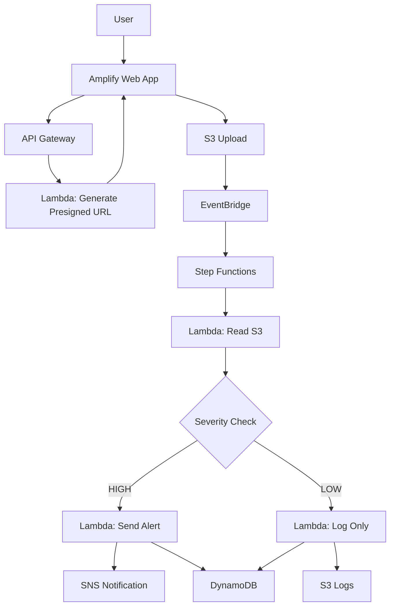

# 🚀 Event-Driven Incident Processing System (Serverless AWS)

---

## 📌 Overview

This project implements a **fully serverless, event-driven incident processing system** using AWS.

Users upload incident data via a web interface, and the system automatically:

1. Stores the file in S3
2. Triggers a workflow using EventBridge
3. Processes the incident using Step Functions
4. Sends alerts for high-severity incidents
5. Stores results in DynamoDB

---

## 🧠 Architecture



---

## 🔄 Workflow

1. User uploads JSON file via frontend
2. API Gateway generates a presigned S3 upload URL
3. File is uploaded directly to S3
4. S3 triggers EventBridge
5. EventBridge starts Step Functions
6. Step Functions:

   * Reads file from S3
   * Checks severity
   * Sends alert (if HIGH)
   * Logs data
   * Saves to DynamoDB

---

## 📁 Project Structure

```bash
incident-system/
│
├── frontend/
│   └── index.html
│
├── lambda/
│   ├── generate_url.py
│   ├── read_s3.py
│   ├── alert.py
│   ├── log.py
│   └── save.py
│
├── stepfunctions/
│   └── state_machine.json
│
└── sample_event.json
```

---

## 💻 Lambda Functions

---

### 1️⃣ Generate Presigned URL

📄 `lambda/generate_url.py`

---

### 2️⃣ Read File from S3

📄 `lambda/read_s3.py`


### 3️⃣ Send Alert (SNS)

📄 `lambda/alert.py`


---

### 4️⃣ Log to S3

📄 `lambda/log.py`


---

### 5️⃣ Save to DynamoDB

📄 `lambda/save.py`


## 🧩 Step Functions

📄 `stepfunctions/state_machine.json`


---

## 🌐 Frontend (Amplify)

📄 `frontend/index.html`


## ⚙️ Setup Guide

---

### 1️⃣ Create S3 Buckets

```text
incident-input-bucket
incident-logs
```

S3 bucket names are global across all AWS accounts, so these exact names are probably taken. Add a unique suffix, for example `incident-input-bucket-<yourname>` and `incident-logs-<yourname>`, and use the same names everywhere below (Lambda environment variable, `log.py`, EventBridge rule).

Enable:

```
Send notifications to EventBridge
```

Leave **Block Public Access** turned on. Browser uploads use a presigned URL, which carries the permission of the Lambda role, so the bucket does not need to be public and no bucket policy is needed. A policy with `Principal: "*"` is rejected while Block Public Access is on.

**Add CORS policy** on `incident-input-bucket`:

```
S3 → incident-input-bucket → Permissions → Cross-origin resource sharing (CORS) → Edit
```

Paste:

```json
[
  {
    "AllowedHeaders": ["*"],
    "AllowedMethods": ["PUT"],
    "AllowedOrigins": ["*"],
    "ExposeHeaders": []
  }
]
```

`OPTIONS` is not a valid value for `AllowedMethods` in S3 CORS (only GET, PUT, POST, DELETE, HEAD). S3 answers the browser preflight automatically once `PUT` is allowed.

---

### 2️⃣ Create DynamoDB

```text
Table: incident-table
Partition key: id
```

---

### 3️⃣ Create SNS

* Create topic
* Subscribe email

---

### 4️⃣ Create Lambda Functions

Upload all scripts

Set environment variables (no trailing spaces in the values):

| Lambda | Variable | Value |
|---|---|---|
| `generate_url` | `bucket_incident` | your input bucket name |

Also replace the placeholders in the code: `LOG_BUCKET` in `log.py` and `TOPIC_ARN` in `alert.py`.

Add IAM permissions to the role of each Lambda. A role that has only `AWSLambdaBasicExecutionRole` cannot sign a working upload URL: S3 checks the signing role when the `PUT` arrives and returns `403 AccessDenied`.

```
S3FullAccess
SNSFullAccess
DynamoDBFullAccess
```

---

### 4.5️⃣ Create IAM Role for Step Functions

* Create a new IAM role with trust policy for `states.amazonaws.com`
* Attach inline policy:

```json
{
  "Effect": "Allow",
  "Action": "lambda:InvokeFunction",
  "Resource": [
    "arn:aws:lambda:REGION:ACCOUNT_ID:function:read_s3",
    "arn:aws:lambda:REGION:ACCOUNT_ID:function:alert",
    "arn:aws:lambda:REGION:ACCOUNT_ID:function:log",
    "arn:aws:lambda:REGION:ACCOUNT_ID:function:save"
  ]
}
```

* Attach this role when creating the Step Functions state machine

---

### 5️⃣ Create API Gateway

* HTTP API
* Route:

```
GET /generate-url
```

* The invoke URL the frontend calls is `https://<api-id>.execute-api.<region>.amazonaws.com/<stage-name>/generate-url`. Include the stage name (for example `prod`) and the `/generate-url` path. Calling the stage root returns `404`.

* Integration:

```
Lambda → generate_url
```

**Enable CORS** with these values:

```
Access-Control-Allow-Origin:  *
Access-Control-Allow-Headers: *
Access-Control-Allow-Methods: GET, OPTIONS
```

---

### 6️⃣ Create Step Functions

* Paste JSON
* Replace Lambda ARNs

---

### 7️⃣ Create EventBridge Rule

Event pattern:

```json
{
  "source": ["aws.s3"],
  "detail-type": ["Object Created"],
  "detail": {
    "bucket": {
      "name": ["incident-input-bucket"]
    }
  }
}
```

Target:

```
Step Functions
```

Create the rule on the `default` event bus. Events from AWS services such as S3 arrive on the default bus, so a custom event bus is not needed.

Create a new IAM role for EventBridge with permission to start the state machine:

```json
{
  "Effect": "Allow",
  "Action": "states:StartExecution",
  "Resource": "arn:aws:states:REGION:ACCOUNT_ID:stateMachine:YOUR_STATE_MACHINE_NAME"
}
```

The trust policy of this role must allow `events.amazonaws.com`:

```json
{
  "Version": "2012-10-17",
  "Statement": [{
    "Effect": "Allow",
    "Principal": { "Service": "events.amazonaws.com" },
    "Action": "sts:AssumeRole"
  }]
}
```

Attach this role to the EventBridge rule target. Wildcards are not accepted in `Principal.Service`, so list each service name. A trust policy that only allows `lambda.amazonaws.com` makes every invocation fail (`FailedInvocations` in the rule metrics) and no execution starts.

---

### 8️⃣ Deploy Frontend

* Upload to Amplify
* Replace API URL

---

## 🧪 Testing

Upload:

`sample_event.json`

---

## 🎯 Expected Flow

```
Upload file
→ S3
→ EventBridge
→ Step Functions
→ Read S3
→ Branch (HIGH/LOW)
→ Alert / Log
→ Save to DynamoDB
```

---

## ⚠️ Common Issues

* EventBridge not enabled in S3
* Wrong bucket name in rule
* Lambda missing permissions
* Invalid JSON format
* CORS error on S3 PUT, `307 Temporary Redirect` — presigned URL uses the global host `<bucket>.s3.amazonaws.com`: set `endpoint_url='https://s3.<region>.amazonaws.com'` and `addressing_style='virtual'` on the boto3 client in `generate_url.py`, along with `signature_version='s3v4'` and the correct `region_name`. Browsers do not follow redirects on the preflight request. The URL host must be `<bucket>.s3.<region>.amazonaws.com`.
* CORS error on S3 PUT — missing S3 CORS policy: add the CORS config to `incident-input-bucket` as shown in Step 1
* `403 Forbidden` on the S3 PUT even though CORS headers are present — the Lambda role that signed the URL has no `s3:PutObject`
* `500` from API Gateway — read the Lambda log in CloudWatch. Typical causes: `os.environ(...)` instead of `os.environ[...]`, a missing `import os`, or a trailing space in the `bucket_incident` value
* `404` from the frontend call — the `API_URL` still contains the placeholder, or lacks the stage name and `/generate-url`
* EventBridge rule shows invocations but Step Functions has no executions — check `FailedInvocations`; the target role trust policy needs `events.amazonaws.com`
* `Invalid bucket name` — the bucket name has a trailing space or uses a name that someone else already owns

---

## 🏁 Conclusion

This project demonstrates a **real-world event-driven architecture** using AWS serverless services, suitable for:

* LKS Cloud Computing competition
* Portfolio projects
* Learning advanced cloud patterns

---
