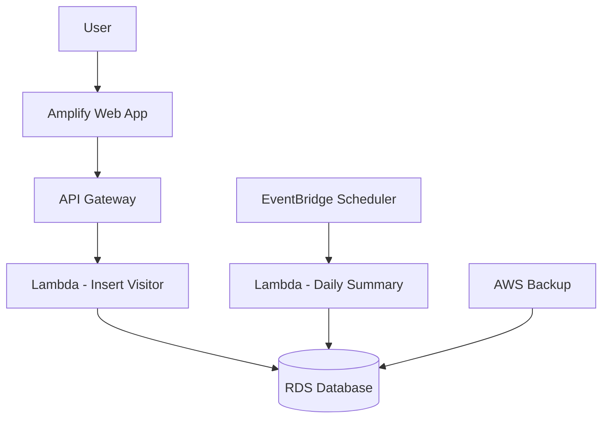
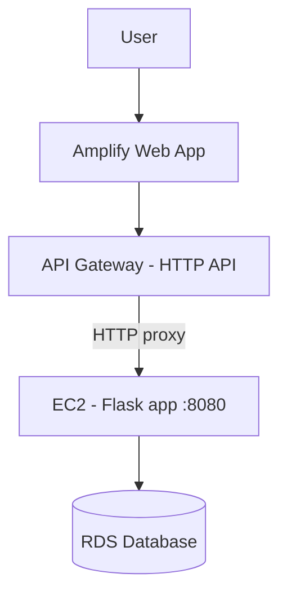

# 📚 Library Visitor App (AWS Serverless)

## 🚀 Overview

This project is a **serverless web application** to record and process library visitors using AWS services.

The system is built with:

* AWS Amplify (Frontend Hosting)
* Amazon API Gateway (API Endpoint)
* AWS Lambda (Backend Logic)
* Amazon RDS (Database)
* Amazon EventBridge (Scheduled Jobs)
* AWS Backup (Database Backup)

### Two flows to try

| | Flow A – Lambda (default) | Flow B – EC2 |
|---|---|---|
| Insert visitor runs on | AWS Lambda (`lambda/insert_visitor.py`) | A small web app on one EC2 instance (`ec2/app.py`) |
| Servers to manage | None | One instance (OS, process, public IP) |
| Scales | Automatically | One instance, you scale it |
| Setup | Steps 3–6 below | [Flow B section](#flow-b--ec2-instead-of-lambda-insert-visitor-only) |

Both flows use the same RDS database, the same API route (`POST /visitor`) and the same `frontend/index.html`, so you can build one, then the other, and compare. Flow B covers the **insert** step only; the daily summary job stays in Flow A.

---

## 🧠 Architecture



---

## 🔄 Workflow

1. User submits visitor form from web
2. Request sent to API Gateway
3. API Gateway triggers Lambda
4. Lambda inserts data into RDS
5. EventBridge runs daily job:

   * Calculate total visitors
   * Store summary
6. AWS Backup automatically backs up database

---

## 📁 Project Structure

```bash
library_visitor_app/
│
├── frontend/
│   └── index.html
│
├── lambda/                  ← Flow A
│   ├── insert_visitor.py
│   └── daily_summary.py
│
├── ec2/                     ← Flow B
│   ├── app.py
│   └── user-data.sh
│
├── database/
│   └── schema.sql
│
└── README.md
```

---

## ⚙️ Setup Guide (Step-by-Step)

---

### 1️⃣ Create RDS Database

1. Go to AWS RDS

2. Create database:

   * Engine: MySQL
   * Template: Free Tier
   * Instance: db.t3.micro

3. Enable:

   * Public Access = YES

4. Configure Security Group:

   ```
   Port: 3306
   Source: 0.0.0.0/0 (for testing only)
   ```

---

### 2️⃣ Create Database Tables

Run SQL:

```sql
CREATE TABLE visitors (
    id INT AUTO_INCREMENT PRIMARY KEY,
    name VARCHAR(100),
    class VARCHAR(20),
    purpose VARCHAR(255),
    visit_time TIMESTAMP DEFAULT CURRENT_TIMESTAMP
);

CREATE TABLE daily_summary (
    id INT AUTO_INCREMENT PRIMARY KEY,
    date DATE,
    total_visitors INT
);
```

---

> **Flow A (Lambda)** continues here with steps 3–6. For **Flow B (EC2)** skip to [Flow B](#flow-b--ec2-instead-of-lambda-insert-visitor-only) after step 2.

### 3️⃣ Create Lambda Functions

Create 2 Lambda functions:

* `insert-visitor`
* `daily-summary`

Runtime:

```
Python 3.11
```

---

### 4️⃣ Install Dependencies (pymysql)

Lambda requires MySQL driver:

```bash
pip install pymysql -t .
zip -r function.zip .
```

Upload to Lambda.

---

### 5️⃣ Set Environment Variables

In Lambda:

```
DB_HOST=your-rds-endpoint
DB_NAME=your-database-name
DB_USER=admin
DB_PASS=password123
```

---

### 6️⃣ Create API Gateway

1. Create HTTP API
2. Create route:

```
POST /visitor
```

3. Integration:

```
Lambda → insert-visitor
```

4. Enable CORS

---

### 7️⃣ Deploy Frontend (Amplify)

1. Go to Amplify
2. Host web app
3. Upload `frontend/index.html`

Update API URL:

```javascript
const API_URL = "YOUR_API_GATEWAY_URL";
```

---

### 8️⃣ Setup EventBridge (Scheduler)

Create rule:

```
cron(*/5 * * * ? *)
```

Target:

```
Lambda → daily-summary
```

---

### 9️⃣ Setup AWS Backup

1. Create Backup Plan
2. Configuration:

   * Frequency: Daily
   * Retention: 7 days
3. Assign resource:

   * RDS instance

---

## 🧪 Testing

### Test API (using Postman)

Example request:

```json
{
  "name": "Budi",
  "class": "10A",
  "purpose": "Reading"
}
```

Expected result:

* Data inserted into RDS
* Daily summary created automatically

---

## Flow B – EC2 instead of Lambda (insert visitor only)

The browser, API Gateway and RDS stay the same. Only the box that runs the insert code changes: a Flask app on an EC2 instance replaces the Lambda function.



Before you start: RDS and the tables from steps 1–2 must exist, and you need the RDS **endpoint**, database name, user and password.

### B1. Security group for the instance

Console: **EC2 → Security Groups → Create security group** → name `lib-visitor-ec2-sg`, default VPC, **Inbound rule**: Custom TCP, port `8080`, Source `0.0.0.0/0` → Create.

> **Note**: A security group is the firewall of the instance. The app listens on 8080, so that port must be open. `0.0.0.0/0` means "from anywhere": acceptable for practice only. There is **no SSH rule**: the whole setup runs from the user data, so nobody needs to log in.

### B2. Launch the instance

Console: **EC2 → Launch instance**

| Setting | Value |
|---|---|
| Name | `lib-visitor-ec2` |
| AMI | Amazon Linux 2023 |
| Instance type | `t3.micro` |
| Key pair | **Proceed without a key pair** |
| Network | default VPC, default subnet, **Auto-assign public IP: Enable** |
| Security group | select existing `lib-visitor-ec2-sg` |
| Advanced details → User data | paste the content of `ec2/user-data.sh` **after editing its first 4 values** (`DB_HOST`, `DB_NAME`, `DB_USER`, `DB_PASS`) |

> **Note**: *User data* is a script the instance runs once, as root, at first boot. This one installs Python packages, writes `ec2/app.py` to `/opt/lib-visitor/`, stores the database settings in `/etc/lib-visitor.json` (readable by root only, so the password is not in the source code), and registers a `systemd` service so the app starts at boot and restarts if it crashes. `gunicorn` is the production web server in front of Flask. Keep a single quote `'` out of the password, because the script wraps the values in single quotes. Anyone with access to the instance can read its user data, so treat this password as practice-only. Startup takes 2–3 minutes.

### B3. Test the app directly

Open the instance's **Public IPv4 address**, then from your computer:

```bash
curl http://<PUBLIC-IP>:8080/health
curl -X POST http://<PUBLIC-IP>:8080/visitor -H 'Content-Type: application/json' \
  -d '{"name":"Budi","class":"10A","purpose":"Reading"}'
```

Expected: `{"status":"ok"}`, then `{"message":"Visitor recorded","visitor_id":1}`. Check the row in your database client.

> **Note**: Test the app **before** adding API Gateway, so a failure has only one possible place. No answer at all means the user data is still running or the security group lacks 8080. `500` means the app cannot reach RDS: check the database settings in the user data and port 3306 in the RDS security group. To read what the instance did at boot: **EC2 → instance → Actions → Monitor and troubleshoot → Get system log**.

### B4. API Gateway in front of the instance

Console: **API Gateway → Create API → HTTP API → Build**

1. **Add integration → HTTP URL** → Method `POST`, URL `http://<PUBLIC-IP>:8080/visitor`.
2. API name `lib-visitor-api-ec2` → Next.
3. Route: Method `POST`, path `/visitor`, integration = the one you just added → Next.
4. Stage `$default`, **Auto-deploy** on → Create.
5. **Develop → CORS → Configure**: Allow-Origin `*`, Allow-Headers `content-type`, Allow-Methods `POST, OPTIONS` → Save.

> **Note**: API Gateway gives you a secure `https` address. Your Amplify page is served over `https`, and a browser refuses to call a plain `http` address from an `https` page (*mixed content*), so the browser must talk to API Gateway, which then forwards to the instance over `http`. With the `$default` stage the URL has no stage in the path: `https://<id>.execute-api.<region>.amazonaws.com/visitor`.

### B5. Frontend and final test

Put the API Gateway URL (ending in `/visitor`) in `frontend/index.html` as `API_URL`, deploy it to Amplify like step 7, and submit the form. Or test the API first:

```bash
curl -X POST https://<API-ID>.execute-api.<REGION>.amazonaws.com/visitor \
  -H 'Content-Type: application/json' -d '{"name":"Siti","class":"10B","purpose":"Study"}'
```

> **Note**: The same `index.html` works for both flows because both expose `POST /visitor`. To compare, build Flow A and Flow B with two different APIs and switch `API_URL`.

### Things to know about Flow B

* **The public IP changes** when the instance is stopped and started again. Then update the integration URL in API Gateway, or attach an **Elastic IP** (it keeps the same address).
* **Port 8080 is open to the internet** and the app has no login. Fine for practice, not for real data.
* **One instance is one point of failure.** If it stops, inserts stop. Lambda (Flow A) does not have this problem.
* **Clean up**: delete the API, terminate the instance, delete the security group `lib-visitor-ec2-sg`. A running instance costs money until terminated.

