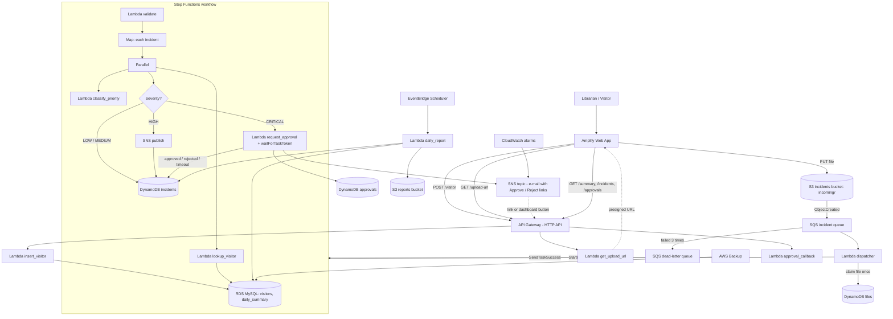

# Module: Library Visitor & Incident Platform

**Duration: 6 Hours – Serverless visitor tracking + event-driven incident processing with human approval**

> **Free Tier Notice**: Lambda, API Gateway, SQS, SNS, DynamoDB, Step Functions (4,000 state transitions per month), Amplify and EventBridge Scheduler are free for this exercise. **RDS (`db.t3.micro`) and AWS Backup are the billable parts**: delete everything (see *Clean up* at the end of `step-by-step.md`) as soon as you finish.

---

## Description of Project and Tasks

*Pustaka Nusantara* is a school library that today writes every visitor on paper and reports problems (a torn book, a lost laptop, an open server-room door) to the head librarian by chat message. Nothing is searchable, nothing is escalated on time, and nobody can tell how many visitors or incidents the library had last week.

The school asks you to modernize this with a **fully serverless** platform. Visitors check in on a web page and are stored in a relational database. Librarians upload incident reports as JSON files, and the platform must process each file automatically: validate it, look up the visitor involved, rank the incident, alert people about serious ones, and keep every incident in a database that the dashboard can query quickly. A **CRITICAL** incident must not be closed automatically: a human has to approve or reject it, and if nobody answers within 15 minutes it must be escalated by itself.

Every night the platform builds a report with the number of visitors and incidents of the previous day, and the database must be backed up. Operators want an alarm when something goes wrong.

You will build the platform layer by layer. After every layer you must show a working checkpoint before you continue.

---

## Architecture



---

## Application

Only build using Python 3.11 (Lambda) and plain HTML/JavaScript (frontend). The frontend must have three views:

1. **Visitor check-in** form.
2. **Report incidents** (upload a JSON file or pasted JSON).
3. **Dashboard** with the last 7 daily summaries, an incident table with a severity filter, and a list of **pending approvals** with Approve / Reject buttons.

An incident file looks like this (see the `data/` folder for more):

```json
{
  "report_id": "rpt-001",
  "incidents": [
    {"incident_id": "inc-1003", "type": "lost_item", "severity": "HIGH",
     "room": "Lobby", "description": "Laptop left unattended", "visitor_id": 1}
  ]
}
```

`severity` is one of `LOW`, `MEDIUM`, `HIGH`, `CRITICAL`. `visitor_id` is optional and points to a row in the `visitors` table.

---

## Tasks

| # | Layer | Task |
|---|---|---|
| 1 | Visitor API | RDS MySQL (public, practice only), Lambda `insert_visitor`, HTTP API `POST /visitor` |
| 2 | Upload | Private S3 bucket with CORS, Lambda that returns a presigned URL, `GET /upload-url` |
| 3 | Queue + dispatcher | S3 → SQS (with DLQ) → Lambda dispatcher with an idempotency table |
| 4 | Workflow | Step Functions: validate the file, `Map` over incidents, write to DynamoDB with direct integrations |
| 5 | Enrich + notify | `Parallel` (RDS lookup + priority), `Choice` by severity, SNS alert for HIGH |
| 6 | Approval | CRITICAL incidents pause with `waitForTaskToken`; approve or reject by e-mail link or dashboard |
| 7 | Report + dashboard | EventBridge Scheduler daily report, read APIs, Amplify dashboard |
| 8 | Operations | AWS Backup for the database, CloudWatch alarms |

---

## Technical Details

- **Region**: `ap-southeast-1` (Singapore)
- **One IAM role for everything**: `lks_learning_role`. All Lambda functions, the Step Functions state machine, the EventBridge Scheduler schedule and the AWS Backup plan use this single role. **The role is already prepared for you**: you do not create roles or edit IAM. Just select `lks_learning_role` whenever a service asks for an execution role. (Instructors: the trust policy and policy list are in `iam/`.)
- **Names**: `lks-libinc-<purpose>-<suffix>`, where `<suffix>` is your own name in lowercase (S3 bucket names are global, so they must be unique).
- **Required tags** on every resource that supports tags: `Project=lks-libinc`, `Environment=practice`, `ManagedBy=LKS-Team`.
- **Access**: the database is public and open on port 3306 for practice only. S3 buckets keep **Block Public Access** turned on. The browser uploads with a presigned URL, never with a public bucket.
- **API**: one HTTP API with the `$default` stage and CORS configured on the API itself.
- **Limits you must respect**: at most 100 incidents per file; the dispatcher must never start the same file twice; an approval waits at most 15 minutes.

---

## Service Details

### RDS MySQL

| Setting | Value |
|---|---|
| Identifier | `lks-libinc-db-<suffix>` |
| Class / storage | `db.t3.micro`, 20 GB gp2 |
| Public access | Yes (practice only), security group port 3306 |
| Database | `library` |
| Tables | `visitors`, `daily_summary` (unique `report_date`) |

### S3

| Bucket | Purpose |
|---|---|
| `lks-libinc-incidents-<suffix>` | Uploaded incident files under `incoming/`; CORS `PUT`; event notification to SQS |
| `lks-libinc-reports-<suffix>` | Daily report JSON under `daily/` |

### SQS

| Queue | Settings |
|---|---|
| `lks-libinc-incident-queue-<suffix>` | Visibility timeout 180 s, redrive to the DLQ after 3 receives, policy that only lets your bucket send |
| `lks-libinc-incident-dlq-<suffix>` | Dead-letter queue |
| `lks-libinc-failed-items-<suffix>` | Incidents that failed inside the workflow |

### DynamoDB (on-demand)

| Table | Key | Notes |
|---|---|---|
| `lks-libinc-files-<suffix>` | `file_key` | One row per file; conditional write = idempotency |
| `lks-libinc-incidents-<suffix>` | `incident_id` | GSI `severity-index` (severity, received_at) and `report-date-index` (report_date, received_at) |
| `lks-libinc-approvals-<suffix>` | `approval_id` | Holds the task token; TTL attribute `ttl` |

### Lambda (Python 3.11, role `lks_learning_role`)

| Function | Trigger | Purpose |
|---|---|---|
| `insert-visitor` | API `POST /visitor` | Insert a visitor into RDS |
| `get-upload-url` | API `GET /upload-url` | Presigned PUT URL for `incoming/` |
| `dispatcher` | SQS (batch 5, partial batch response) | Claim the file once, start the workflow |
| `validate` | Step Functions | Read the file, split valid and invalid incidents |
| `lookup-visitor` | Step Functions (Parallel) | Find the visitor in RDS |
| `classify-priority` | Step Functions (Parallel) | Priority number and SLA minutes |
| `request-approval` | Step Functions (`waitForTaskToken`) | Store the token, e-mail Approve / Reject links |
| `approval-callback` | API `GET/POST /approval`, `GET /approvals` | Resume the workflow with `SendTaskSuccess` |
| `daily-report` | EventBridge Scheduler | Count visitors and incidents, write report |
| `get-summary`, `get-incidents` | API | Data for the dashboard |

All functions that talk to MySQL use a Lambda layer with `pymysql` and `cryptography`.

### Step Functions

Standard workflow `lks-libinc-workflow-<suffix>`. It must use `Map` (concurrency 5), `Parallel`, `Choice`, `Retry`/`Catch`, `waitForTaskToken` with a 900 second timeout, and at least three **direct service integrations** (DynamoDB `putItem` and `updateItem`, SNS `publish`, SQS `sendMessage`).

### EventBridge Scheduler

Schedule `cron(5 0 * * ? *)` (UTC) that invokes `daily-report`.

### AWS Backup and CloudWatch

Daily backup rule for the database kept for 7 days. Alarms on the DLQ (`ApproximateNumberOfMessagesVisible >= 1`) and on `ExecutionsFailed >= 1`, both sending to the SNS topic.

---

## Known Limits (practice only)

This module is built for learning and keeps the setup simple on purpose. Do not copy these shortcuts into a real system:

- **The API has no authentication.** Anyone who knows the API address can check in a visitor, ask for an upload URL, list pending approvals and answer them. In production put an authorizer (Cognito, JWT or IAM) in front of `/upload-url`, `/approvals` and `/approval`, and limit approval to named approvers.
- **Approving by link uses `GET`.** An e-mail link can only be opened, so the link changes state. The `approval_id` is a random 128-bit value that works like a password; a real system would add a signed, expiring token and a confirmation page that asks for a `POST`.
- **An uploaded file can overwrite an incident with the same `incident_id`.** The workflow stores incidents with a plain `putItem`, so re-uploading is idempotent for the exercise. In production derive the key on the server (for example file key + id) or use a conditional write, and restrict the upload size with a presigned `POST` and `content-length-range`.
- **Text from uploaded files is untrusted.** The approval page and the approval e-mail already escape or flatten it. Keep doing that for every new output you add.
- **The database is open to the internet on port 3306**, and the shared role uses full-access policies.

---

## Validation

At the end you must demonstrate:

1. A visitor submitted on the web page exists in `visitors`.
2. Uploading `data/incidents-valid.json` creates exactly three items in the incidents table, and uploading the same S3 key again does **not** start a second execution.
3. `data/incidents-mixed.json` stores the two valid incidents and reports two invalid ones; `data/incidents-broken.json` ends the execution as failed and marks the file `FAILED`.
4. An incident that names an existing `visitor_id` is stored with that visitor's name; one without it is stored as `unknown`.
5. A HIGH incident publishes to SNS.
6. A CRITICAL incident pauses the execution; approving it (by link or dashboard button) resumes it and stores status `APPROVED`. Doing nothing for 15 minutes stores `ESCALATED`.
7. Running `daily-report` for a date fills `daily_summary`, writes `daily/<date>.json` and sends an SNS message.
8. The dashboard shows summaries, a filtered incident list and pending approvals.
9. The backup vault has a recovery point and both alarms exist.

---

## Files

```
lks-library-incident-platform/
├── README.md                     ← this exam question
├── step-by-step.md               ← answer key, layer by layer
├── app/
│   ├── lambda/                   ← 11 Lambda functions
│   ├── statemachine/             ← workflow-layer4/5/6.asl.json
│   ├── config/                   ← S3 and API CORS
│   └── frontend/index.html
├── iam/                          ← lks_learning_role trust policy + policy list (instructor)
├── sql/                          ← schema.sql (+ init_db.py helper)
└── data/                         ← valid, critical, mixed and broken sample files
```
