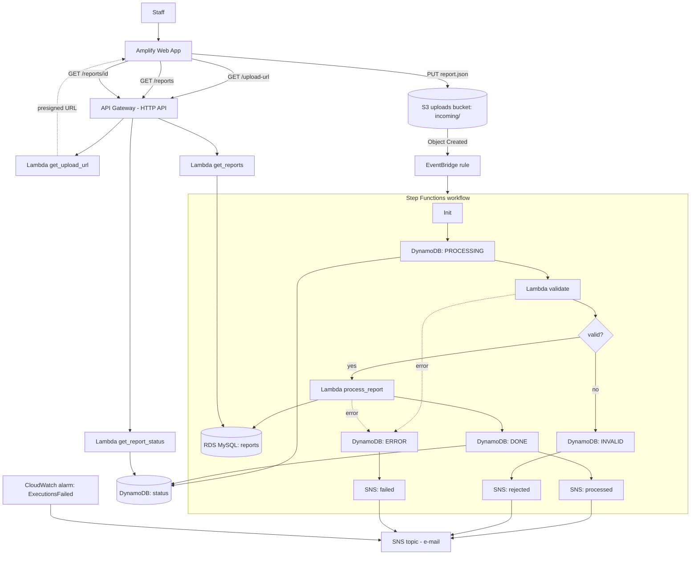

# Module: Report Pipeline

**Duration: 3 Hours – Serverless report processing with S3, EventBridge, Step Functions, RDS and DynamoDB**

> **Free Tier Notice**: Lambda, API Gateway, SNS, DynamoDB, Step Functions (4,000 state transitions per month), Amplify and EventBridge are free for this exercise. **RDS (`db.t3.micro`) is the only billable part**: delete everything (see *Clean up* at the end of `step-by-step.md`) as soon as you finish.

---

## Description of Project and Tasks

*Toko Sejahtera* sends its sales report to the head office as a file at the end of every day. Today somebody opens each file by hand, checks it, types the totals into a spreadsheet and e-mails the result. Mistakes are common, and nobody can tell whether a report was already processed.

The company asks you to automate this with a **serverless** pipeline. A staff member uploads a JSON report on a web page. The platform must then, without any manual step: check the report, calculate the number of rows and the total amount, store the result in a database, tell the owner by e-mail, and keep a status for every report so the staff member can see whether it is still being processed, finished, rejected or failed.

You build the pipeline layer by layer. After every layer you show a working checkpoint before you continue.

---

## Architecture



---

## Application

Only build using Python 3.11 (Lambda) and plain HTML/JavaScript (frontend). The frontend must have three views:

1. **Upload report**: pick or edit a JSON report, upload it, and watch the status change.
2. **Reports**: the processed reports stored in RDS.
3. **Check status**: look up one report by its id.

A report looks like this (more samples are in `data/`):

```json
{
  "filename": "sales-november.json",
  "data": [
    {"item": "Notebook", "qty": 10, "price": 15000},
    {"item": "Pen", "qty": 25, "price": 3500}
  ]
}
```

A report is **valid** when it is a JSON object with `filename` and a non-empty `data` list, and every row has a non-empty `item`, a whole-number `qty` above 0 and a `price` of 0 or more. The **total amount** is the sum of `qty × price`.

---

## Tasks

| # | Layer | Task |
|---|---|---|
| 1 | Reports API | RDS MySQL (public, practice only), a Lambda layer with the MySQL driver, Lambda `get_reports`, HTTP API `GET /reports` |
| 2 | Upload | Private S3 bucket with CORS, Lambda that returns a presigned URL, `GET /upload-url` |
| 3 | Workflow | SNS topic and a Step Functions state machine: validate, `Choice`, process into RDS, notify. Start it by hand with a test input |
| 4 | Automatic start | Turn on EventBridge for the bucket and create a rule that starts the workflow for every new report |
| 5 | Status tracking | DynamoDB status table written by the workflow (direct integration), `GET /reports/{id}` |
| 6 | Dashboard + alarm | Amplify web page, CloudWatch alarm on failed executions |

---

## Technical Details

- **Region**: `ap-southeast-1` (Singapore)
- **One IAM role for everything**: `lks_learning_role`. All Lambda functions, the Step Functions state machine and the EventBridge rule target use this single role. **The role is already prepared for you**: you do not create roles or edit IAM. Just select `lks_learning_role` whenever a service asks for an execution role. (Instructors: the trust policy and policy list are in `iam/`.)
- **Networking**: this module does not use VPC features. Keep every networking setting on its default (default VPC, default subnet group). The database is reachable from the internet and protected only by its security group and password, for practice only.
- **Names**: `lks-rp-<purpose>-<suffix>`, where `<suffix>` is your own name in lowercase (S3 bucket names are global, so they must be unique).
- **Tags** on every resource that supports tags: `Project=lks-rp`, `Environment=practice`, `ManagedBy=LKS-Team`.
- **Access**: the S3 bucket keeps **Block Public Access** turned on. The browser uploads with a presigned URL.
- **API**: one HTTP API with the `$default` stage and CORS configured on the API itself.

---

## Service Details

### RDS MySQL

| Setting | Value |
|---|---|
| Identifier | `lks-rp-db-<suffix>` |
| Class / storage | `db.t3.micro`, 20 GB gp2 |
| Public access | Yes (practice only), security group port 3306 |
| Database | `reports` |
| Table | `reports` (`report_id` is `UNIQUE`) |

### S3

| Bucket | Purpose |
|---|---|
| `lks-rp-uploads-<suffix>` | Uploaded reports under `incoming/`; CORS `PUT`; EventBridge notifications on |

### Lambda (Python 3.11, role `lks_learning_role`)

| Function | Trigger | Purpose |
|---|---|---|
| `get-upload-url` | API `GET /upload-url` | Presigned PUT URL for `incoming/<id>.json` |
| `validate` | Step Functions | Read the file and check the rules; never crash on a bad file, answer `valid: false` with a reason |
| `process-report` | Step Functions | Read exactly the version that was validated (`IfMatch` with the ETag from `validate`), count rows, sum the amount, insert or update the row in RDS |
| `get-reports` | API `GET /reports` | Latest 50 rows from RDS |
| `get-report-status` | API `GET /reports/{id}` | Status item from DynamoDB (404 when missing) |

`process-report` and `get-reports` use a Lambda layer with `pymysql` and `cryptography`.

### Step Functions

Standard workflow `lks-rp-workflow-<suffix>` with `Choice`, `Retry` and `Catch`, and **direct service integrations** for SNS `publish` and (layer 5) DynamoDB `putItem` and `updateItem`.

### EventBridge

Rule on the `default` event bus for `Object Created` events of your bucket under `incoming/`, target = the state machine.

### DynamoDB (on-demand)

| Table | Key | Attributes |
|---|---|---|
| `lks-rp-status-<suffix>` | `report_id` | `status` (`PROCESSING`, `DONE`, `INVALID`, `ERROR`), `message`, `record_count`, `total_amount`, `updated_at` |

---

## Known Limits (practice only)

- **The API has no authentication.** Anyone who knows the address can list reports and ask for an upload URL. In production put an authorizer (Cognito, JWT or IAM) in front of the API and record who uploaded each report.
- **The 1 MB limit is checked after the upload.** A presigned `PUT` cannot limit the size, so a larger file is stored in S3 first and rejected afterwards. In production use a presigned `POST` with a `content-length-range` condition. The S3 CORS rule also allows any origin; limit it to your dashboard's address once you know it.
- **The database is open to the internet on port 3306**, and the shared role uses full-access policies.
- **Text from uploaded files is untrusted.** The dashboard escapes it before showing it. Keep doing that for every output you add.

---

## Validation

At the end you must demonstrate:

1. `GET /reports` answers `[]` before any report exists.
2. Uploading `data/report-valid.json` starts the workflow by itself, the execution **Succeeded**, RDS has one row with `record_count` 3 and `total_amount` `262502.50` (10×15000 + 25×3500 + 5×5000.5), and DynamoDB shows `DONE`.
3. `data/report-missing-data.json` and `data/report-bad-row.json` end as **Succeeded** with status `INVALID` and a clear reason, and **no row** is added to RDS.
4. `data/report-broken.json` (not JSON) is rejected as `INVALID` with the reason `file is not valid JSON`.
5. Uploading the same report id twice never creates two rows in RDS.
6. Every outcome publishes one SNS message.
7. The dashboard shows the status moving from `PROCESSING` to `DONE`, lists the report, and finds it by id.
8. The CloudWatch alarm exists.

---

## Files

```
lks-report-pipeline/
├── README.md                     ← this exam question
├── step-by-step.md               ← answer key, layer by layer (AWS web console)
├── app/
│   ├── lambda/                   ← 5 Lambda functions
│   ├── statemachine/             ← workflow-layer3 (no DynamoDB) and workflow-layer5 (with DynamoDB)
│   ├── config/                   ← S3 and API CORS
│   └── frontend/index.html
├── iam/                          ← lks_learning_role trust policy + policy list (instructor)
├── sql/schema.sql
└── data/                         ← valid, missing-data, bad-row and broken sample reports
```
