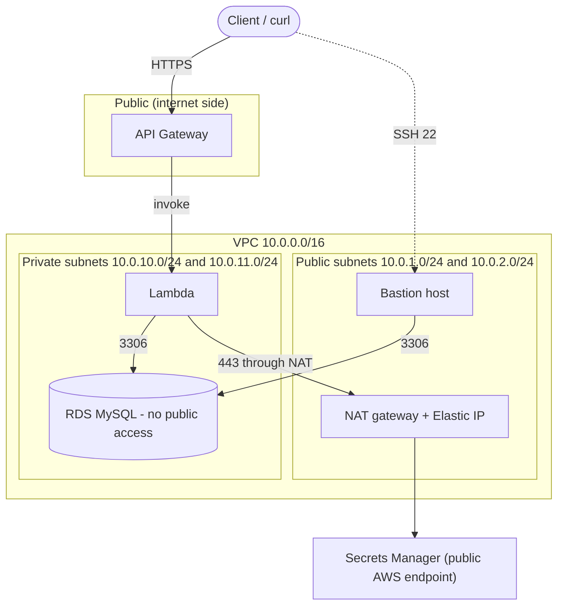

# Step-by-Step – Serverless Private API (build the VPC by hand, AWS web console)

You build a small API whose database is **not reachable from the internet**. You create every network piece yourself in the console (VPC, subnets, gateways, route tables, security groups), so you see what each one does. Every action is followed by a **Note** that says what it does and why.

You build it in 7 layers (plus an optional break-it lab). Each layer adds one idea and ends with a **checkpoint**. Do not start the next layer before the checkpoint passes.

> The same architecture is also available as one CloudFormation template (`template.yaml`, `scripts/deploy.sh`). Use the template when you want it built in minutes; use this guide to learn why each piece exists.

## Layer Overview

| Layer | What You Build | Checkpoint |
|---|---|---|
| **1** | VPC, 4 subnets, internet gateway, public route table | Public subnets route to the internet gateway, private subnets do not |
| **2** | NAT gateway and private route table | Private subnets route to the NAT gateway |
| **3** | 3 security groups | RDS accepts 3306 only from Lambda and the bastion |
| **4** | RDS MySQL in the private subnets | The database exists and **cannot** be reached from the internet |
| **5** | Bastion host | You reach the database from the bastion |
| **6** | Lambda inside the VPC | A test event returns `200` and reads the table |
| **7** | HTTP API in front of the Lambda | `curl` can create, list and delete items |

## Architecture



---

## Before You Start

- Region: **Asia Pacific (Singapore) `ap-southeast-1`**. Check the region selector (top right) in **every** service.
- Your **suffix**: your name in lowercase letters and digits, for example `dana`. It goes in every name (`lks-<purpose>-<suffix>`).

> **Note**: In a shared account the suffix stops you from changing a classmate's VPC, and it keeps names unique.

- **IAM is already done for you.** When Lambda asks for an execution role, choose the existing **`lks_learning_role`** (*Use an existing role*). Never create a role. (The permissions it needs are in the *Instructor appendix*.)
- You need the files `lambda/lambda_function.py` from this folder on your computer.
- **CloudShell** is the `>_` icon in the top bar: a terminal inside the console, in the same region and already signed in. You use it for `curl` and for building one zip.
- **Cost warning**: the **NAT gateway** (about USD 0.045 per hour plus data), the **RDS instance** and the **EC2 bastion** cost money while they exist. Follow *Clean up* at the end the same day.

---

## Layer 1 – VPC, subnets and internet gateway

> **What you build**: a private network with two public and two private subnets, and a route to the internet for the public ones only.

### Step 1: Create the VPC

Console: **VPC → Your VPCs → Create VPC**: *VPC only*, Name `lks-vpc-<suffix>`, IPv4 CIDR `10.0.0.0/16` → Create VPC.

> **Note**: A VPC is your own private network inside AWS. `10.0.0.0/16` is its address range: 65,536 private addresses (`10.0.0.0` to `10.0.255.255`). Nothing outside can reach it until you add a gateway. Choose *VPC only*, not *VPC and more*: the wizard would build everything for you and hide the lesson.

### Step 2: Create four subnets

Console: **VPC → Subnets → Create subnet**: pick `lks-vpc-<suffix>` and add four subnets in one go (**Add new subnet**):

| Name | Availability Zone | IPv4 CIDR |
|---|---|---|
| `lks-public-1-<suffix>` | `ap-southeast-1a` | `10.0.1.0/24` |
| `lks-public-2-<suffix>` | `ap-southeast-1b` | `10.0.2.0/24` |
| `lks-private-1-<suffix>` | `ap-southeast-1a` | `10.0.10.0/24` |
| `lks-private-2-<suffix>` | `ap-southeast-1b` | `10.0.11.0/24` |

> **Note**: A subnet is a slice of the VPC range that lives in **one** Availability Zone (one data centre group). Each `/24` holds 256 addresses (AWS keeps 5 for itself). Two zones matter because RDS refuses a subnet group that sits in only one. The names say *public* and *private*, but at this point **all four are identical**: a subnet is public only when its route table sends traffic to an internet gateway, which you do next.

### Step 3: Give the public subnets a public IP automatically

For `lks-public-1` and `lks-public-2`: select the subnet → **Actions → Edit subnet settings** → tick **Enable auto-assign public IPv4 address** → Save.

> **Note**: A server launched in a public subnet then gets a public address by itself (the bastion needs one). The private subnets keep the setting off, so nothing launched there is ever given a public address.

### Step 4: Create and attach the internet gateway

Console: **VPC → Internet gateways → Create internet gateway**: Name `lks-igw-<suffix>` → Create. Then **Actions → Attach to VPC** → `lks-vpc-<suffix>`.

> **Note**: An internet gateway is the door between the VPC and the internet. It exists for no VPC until you attach it, and a VPC can have only one.

### Step 5: Create the public route table

Console: **VPC → Route tables → Create route table**: Name `lks-public-rt-<suffix>`, VPC `lks-vpc-<suffix>`. Open it → **Routes → Edit routes → Add route**: Destination `0.0.0.0/0`, Target **Internet Gateway** → `lks-igw-<suffix>` → Save. Then **Subnet associations → Edit subnet associations** → tick `lks-public-1` and `lks-public-2` → Save.

> **Note**: A route table is a list of "traffic for this range goes there". Every table already has `10.0.0.0/16 → local`, which lets everything inside the VPC talk to each other. `0.0.0.0/0` means "everything else", and sending it to the internet gateway is **what makes a subnet public**. A route table only applies to the subnets *associated* with it, so the last step matters.

**Layer 1 checkpoint — verify before continuing:**
- [ ] **VPC → Subnets**: four subnets, in two zones, with the four CIDRs above
- [ ] `lks-public-rt` shows the route `0.0.0.0/0 → igw-…` and two associated subnets
- [ ] Open `lks-private-1` → **Route table** tab: only `10.0.0.0/16 → local` (it uses the VPC's *main* route table, which has no internet route)

---

## Layer 2 – NAT gateway and private route table

> **What you build**: a way for private subnets to **start** connections to the internet (for example to Secrets Manager) without letting the internet start connections to them.

### Step 1: Create the NAT gateway

Console: **VPC → NAT gateways → Create NAT gateway**: Name `lks-nat-<suffix>`, Subnet **`lks-public-1-<suffix>`**, Connectivity type **Public**, **Allocate Elastic IP** → Create. Wait until the status is **Available** (about 2 minutes).

> **Note**: A NAT gateway lets private servers go **out**: it replaces their private address with its own public address (the Elastic IP) and sends the answer back to them. Nobody outside can start a connection **in** through it. It must live in a **public** subnet because it needs the internet gateway itself. It is billed per hour, so do not forget it.

### Step 2: Create the private route table

Console: **VPC → Route tables → Create route table**: Name `lks-private-rt-<suffix>`, VPC `lks-vpc-<suffix>`. Open it → **Routes → Edit routes → Add route**: Destination `0.0.0.0/0`, Target **NAT Gateway** → `lks-nat-<suffix>` → Save. Then **Subnet associations → Edit subnet associations** → tick `lks-private-1` and `lks-private-2` → Save.

> **Note**: Same idea as the public table, one difference: the "everything else" route points at the NAT gateway, not at the internet gateway. That one difference is what separates *public* from *private*. This is also why Lambda will be able to reach Secrets Manager later: Secrets Manager is a public AWS service, and a Lambda inside the VPC has no other way out.

**Layer 2 checkpoint — verify before continuing:**
- [ ] The NAT gateway is **Available** and sits in `lks-public-1`
- [ ] `lks-private-rt` shows `0.0.0.0/0 → nat-…` and two associated subnets

---

## Layer 3 – Security groups

> **What you build**: three firewalls that say exactly who may talk to whom.

### Step 1: Create the three groups

Console: **VPC → Security groups → Create security group**, three times, all in VPC `lks-vpc-<suffix>`:

| Name | Description | Inbound rules |
|---|---|---|
| `lks-bastion-sg-<suffix>` | Bastion host | **SSH** (22) from **Anywhere-IPv4** |
| `lks-lambda-sg-<suffix>` | Lambda function | none |
| `lks-rds-sg-<suffix>` | RDS database | none yet |

> **Note**: A security group is a firewall attached to a resource. It is *stateful*: if a connection is allowed in, the answer is allowed out automatically. The bastion's SSH rule is open to the world only because this is practice; in real life it is your own IP or no SSH at all. The RDS group is left empty on purpose: it refers to the other two groups, which must exist first.

### Step 2: Let RDS accept connections from Lambda and the bastion

Open `lks-rds-sg` → **Inbound rules → Edit inbound rules → Add rule**, twice: Type **MySQL/Aurora** (3306), Source **Custom** → type `lks-lambda-sg` and pick it from the list; second rule the same with `lks-bastion-sg` → Save rules.

> **Note**: The source is a **security group**, not an IP address. It means "anything wearing that group may connect". Lambda and the bastion get new addresses all the time, so a rule by address would break; a rule by group never does. No other thing in the VPC, and nothing on the internet, can reach port 3306.

### Step 3: Restrict what Lambda may do outbound

Open `lks-lambda-sg` → **Outbound rules → Edit outbound rules**: **delete** the default *All traffic* rule, then add: Type **MySQL/Aurora** (3306), Destination `lks-rds-sg`; and Type **HTTPS** (443), Destination **Anywhere-IPv4** → Save rules.

> **Note**: By default every group allows all outbound traffic. Here Lambda may only talk to the database (3306) and to HTTPS services (443, for Secrets Manager through the NAT gateway). If someone breaks into the function, it still cannot call out anywhere else. Name lookups (DNS) are not blocked by these rules.

**Layer 3 checkpoint — verify before continuing:**
- [ ] `lks-rds-sg` inbound: two rules on 3306, sources `lks-lambda-sg` and `lks-bastion-sg`
- [ ] `lks-lambda-sg` has **no** inbound rule and exactly two outbound rules (3306 and 443)

---

## Layer 4 – RDS MySQL in the private subnets

> **What you build**: a database that lives only inside the private subnets.

### Step 1: Create the DB subnet group

Console: **RDS → Subnet groups → Create DB subnet group**: Name `lks-db-subnets-<suffix>`, Description `private subnets`, VPC `lks-vpc-<suffix>`, Availability Zones `ap-southeast-1a` and `ap-southeast-1b`, Subnets **`10.0.10.0/24` and `10.0.11.0/24` only** → Create.

> **Note**: A DB subnet group tells RDS *which subnets* it may place the database in. Picking only the private ones guarantees the database can never end up in a public subnet. If you let the create-database wizard make a group for you, it adds **every** subnet of the VPC, public ones included.

### Step 2: Create the database

Console: **RDS → Create database**

| Setting | Value |
|---|---|
| Creation method | Standard create |
| Engine | MySQL (latest 8.4) |
| Template | **Free tier** (or Dev/Test) |
| DB instance identifier | `lks-db-<suffix>` |
| Master username | `admin` |
| Credentials management | **Managed in AWS Secrets Manager** (default key) |
| Instance class | `db.t3.micro` |
| Storage | gp2, 20 GiB, untick *Enable storage autoscaling* |
| Compute resource | **Don't connect to an EC2 compute resource** |
| VPC | `lks-vpc-<suffix>` |
| DB subnet group | `lks-db-subnets-<suffix>` |
| Public access | **No** |
| VPC security group | **Choose existing** → `lks-rds-sg-<suffix>` (remove `default`) |
| Additional configuration → Initial database name | `lksdb` |
| Backup retention | 1 day |
| Deletion protection | untick |

Press **Create database** and wait until the status is **Available** (about 10 minutes).

> **Note**: **Public access = No** means the database gets only a private address, so it is unreachable from the internet whatever the security group says. *Managed in Secrets Manager* makes AWS create a strong password and store it in a secret named `rds!db-…`; you never type or see a password in code. *Initial database name* creates the empty database `lksdb` for you. Deletion protection is off so you can delete it when you finish.

### Step 3: Note the two values you need later

On the database page: **Connectivity & security → Endpoint**. In **Secrets Manager** open the secret whose name starts with `rds!db-` and copy its **Secret ARN**.

> **Note**: The endpoint is the database's address (it resolves to a private `10.0.x.x` address). The secret holds `username` and `password` as JSON. The Lambda will receive the secret's ARN and read the password itself.

**Layer 4 checkpoint — verify before continuing:**
- [ ] RDS shows `lks-db-<suffix>`, status **Available**, **Publicly accessible: No**, VPC `lks-vpc-<suffix>`
- [ ] Prove it is private. Open **CloudShell** and run (use your endpoint):

```bash
timeout 6 bash -c '</dev/tcp/<RDS-ENDPOINT>/3306' && echo "OPEN" || echo "NOT REACHABLE from the internet side"
```

→ `NOT REACHABLE from the internet side`

> **Note**: CloudShell is outside your VPC, like any computer on the internet, so it must fail. In the next layer you reach the same database from **inside**.

---

## Layer 5 – Bastion host

> **What you build**: one small server inside the VPC that you can log in to, to prove the database works.

### Step 1: Launch the bastion

Console: **EC2 → Launch instance**

| Setting | Value |
|---|---|
| Name | `lks-bastion-<suffix>` |
| AMI | Amazon Linux 2023 |
| Instance type | `t3.micro` |
| Key pair | **Proceed without a key pair** |
| Network settings → Edit | VPC `lks-vpc-<suffix>`, Subnet **`lks-public-1-<suffix>`**, Auto-assign public IP **Enable**, Security group **Select existing** → `lks-bastion-sg-<suffix>` |

> **Note**: A *bastion host* (jump box) is the one door into a private network: it sits in a **public** subnet, so you can reach it, and it can reach the private subnets, so it reaches the database. Without a key pair you log in through *EC2 Instance Connect* from the browser, which is why the SSH rule on its security group is open.

### Step 2: Connect and test the database from inside

Console: **EC2 → Instances →** select the bastion → **Connect → EC2 Instance Connect → Connect**. In the terminal that opens (use your endpoint; the password comes from the secret: **Secrets Manager → the `rds!db-` secret → Retrieve secret value → password**):

```bash
sudo dnf install -y python3-pip
pip3 install --user pymysql cryptography
python3 - <<'EOF'
import pymysql
conn = pymysql.connect(host="<RDS-ENDPOINT>", user="admin", password="<PASSWORD>", database="lksdb", connect_timeout=5)
cur = conn.cursor()
cur.execute("SELECT 1"); print(cur.fetchall())
cur.execute("SHOW TABLES"); print(cur.fetchall())
EOF
```

> **Note**: This is the same connection Lambda will make later, so it separates the "network works" problem from the "code works" problem. `cryptography` is needed because MySQL 8.4 logs in with `caching_sha2_password`. If the last command **times out**, the rule is wrong: check that `lks-rds-sg` allows 3306 from `lks-bastion-sg`.

**Layer 5 checkpoint — verify before continuing:**
- [ ] The script prints `((1,),)` and then `()` (the database is empty)
- [ ] The same command from CloudShell (layer 4) failed, and from the bastion it works: that difference **is** the private network

---

## Layer 6 – Lambda inside the VPC

> **What you build**: the function that talks to the database, running inside the private subnets.

### Step 1: Build the `pymysql` layer (CloudShell)

```bash
mkdir -p layer/python && cd layer
pip install pymysql cryptography -t python \
  --platform manylinux2014_x86_64 --python-version 3.12 --implementation cp --only-binary=:all:
zip -q -r pymysql-layer.zip python
```

Then **Actions → Download file** → `layer/pymysql-layer.zip`. Console: **Lambda → Layers → Create layer**: name `lks-pymysql-<suffix>`, upload the zip, compatible runtime **Python 3.12**, architecture **x86_64** → Create.

> **Note**: Lambda has no MySQL driver, so you package one. `cryptography` contains compiled code and CloudShell runs a different Python, so the `--platform` and `--python-version` options download the build for **Lambda's Python 3.12**; without them the function fails with an import error.

### Step 2: Create the function

Console: **Lambda → Create function → Author from scratch**: name `lks-items-<suffix>`, runtime **Python 3.12**, **Change default execution role → Use an existing role → `lks_learning_role`**. Expand **Advanced settings → Enable VPC**: VPC `lks-vpc-<suffix>`, Subnets **`lks-private-1` and `lks-private-2` only**, Security group **`lks-lambda-sg-<suffix>`** → Create function.

> **Note**: A Lambda is normally outside any VPC. Putting it **in** the VPC is the only way it can reach the private database. Lambda then creates a network interface (an ENI) in each private subnet you choose, wearing `lks-lambda-sg`. Choose the *private* subnets: a Lambda in a public subnet still gets **no** internet access (it has no public address), which surprises many people. The shared role carries the permission to create those interfaces.

### Step 3: Put in the code, the layer and the settings

1. **Code** tab → replace everything in `lambda_function.py` with the content of `lambda/lambda_function.py` → **Deploy**.
2. **Code → Layers → Add a layer → Custom layers** → `lks-pymysql-<suffix>` → Add.
3. **Configuration → Environment variables → Edit**: `SECRET_ARN` = the secret's ARN, `DB_HOST` = the RDS endpoint, `DB_NAME` = `lksdb`.
4. **Configuration → General configuration → Edit**: Timeout **30 sec**, Memory **256 MB**.

> **Note**: The password is **not** in the environment: the function receives only the *ARN* and asks Secrets Manager for the password at run time, so the password never appears in the console or in code. A Lambda in a VPC starts slower (the first call creates its network interface), and 30 seconds gives it room. The handler stays `lambda_function.lambda_handler`.

### Step 4: Test inside the console

**Test** tab → create an event `list-items` with this JSON → Test:

```json
{"requestContext": {"http": {"method": "GET"}}, "rawPath": "/items"}
```

Then a second event `create-item`:

```json
{"requestContext": {"http": {"method": "POST"}}, "rawPath": "/items", "body": "{\"name\": \"item1\", \"value\": \"hello\"}"}
```

> **Note**: These are the shape of the event an HTTP API (payload format 2.0) sends: the method is under `requestContext.http` and the path in `rawPath`, and the body arrives as a **string**. The first call also creates the table `items`. If the first test **times out after 30 seconds**, the function cannot reach Secrets Manager: check the NAT route (layer 2) and the `443` outbound rule (layer 3). If it fails with a connection error to the database, check the `3306` rules.

**Layer 6 checkpoint — verify before continuing:**
- [ ] `list-items` returns `"statusCode": 200` and `"body": "[]"`
- [ ] `create-item` returns `201`, then `list-items` shows the item (with its `id` and `created_at`)
- [ ] **Lambda → Configuration → VPC** shows the two private subnets and `lks-lambda-sg`

---

## Layer 7 – HTTP API in front of the Lambda

> **What you build**: a public address for the API, while the database stays private.

### Step 1: Create the API

Console: **API Gateway → Create API → HTTP API → Build**

1. **Add integration → Lambda** → region `ap-southeast-1` → `lks-items-<suffix>`.
2. API name `lks-private-api-<suffix>` → Next.
3. Routes: add three routes, all with that integration: `GET /items`, `POST /items`, `DELETE /items/{id}` → Next.
4. Stages: keep **`$default`** with **Auto-deploy** on → Next → Create.

> **Note**: API Gateway is the only public part. It sits **outside** the VPC and invokes the Lambda through AWS's own network, so no inbound path to the VPC is ever opened. `{id}` is a *path parameter*: whatever follows `/items/` arrives in `pathParameters.id`. With the `$default` stage the address has **no stage name** in its path: `https://<id>.execute-api.ap-southeast-1.amazonaws.com/items`. When you attach a Lambda in the console it also adds the permission that lets API Gateway invoke it.

### Step 2: Call it (CloudShell)

On the API's page copy the **Invoke URL**, then in CloudShell:

```bash
API=https://<id>.execute-api.ap-southeast-1.amazonaws.com
curl -s $API/items
curl -s -X POST $API/items -H 'Content-Type: application/json' -d '{"name":"item2","value":"from curl"}'
curl -s $API/items
curl -s -X DELETE $API/items/1
curl -s -X DELETE $API/items/999
```

> **Note**: The `DELETE` of an id that does not exist answers `404 {"error": "item not found"}` and a request without a `name` answers `400`: the function checks its input before it touches the database. Every other path answers `{"message":"Not Found"}` from API Gateway itself.

**Layer 7 checkpoint — verify before continuing:**
- [ ] `POST` answers `201` with an `id`; `GET` lists it
- [ ] `DELETE /items/<id>` answers `200`, and a second `DELETE` of the same id answers `404`
- [ ] From CloudShell the database is still **not reachable** (layer 4 check): the API works, the database is still private

---

## Optional – Break it on purpose

Learn what each piece does by removing it.

1. **Private route table → Routes → Edit routes →** delete the `0.0.0.0/0 → nat-…` route → Save.
2. Force a fresh Lambda environment: **Lambda → Configuration → General configuration → Edit → Description** → change it → Save. Then run `list-items` again.
3. The test waits the full 30 seconds and ends with a **Task timed out** error.
4. Put the route back (Target: NAT Gateway) and test again: it works.

> **Note**: With no route out, the function cannot reach Secrets Manager, and a network call with no answer simply waits for the timeout. In step 2 you create a new execution environment on purpose: a *warm* one keeps its database connection from earlier calls, never calls Secrets Manager again, and would hide the problem. The same experiment with the `3306` rule (remove it from `lks-rds-sg`) fails fast with a connection error instead.

---

## Clean up

Delete in this order the **same day** (NAT gateway and RDS cost money):

1. **API Gateway** → select the API → Actions → Delete
2. **Lambda** → delete `lks-items-<suffix>` and the layer (all versions)
3. **EC2** → terminate `lks-bastion-<suffix>`
4. **RDS** → delete the database (untick *Create final snapshot*, tick *Delete automated backups*), then **Subnet groups** → delete `lks-db-subnets-<suffix>`
5. **Secrets Manager** → the managed secret is deleted with the database; check that it is gone
6. **VPC → NAT gateways** → delete `lks-nat-<suffix>`, wait until it is **Deleted**, then **Elastic IPs** → release its address
7. **VPC → Security groups** → delete the three `lks-…-sg-<suffix>` groups (delete `lks-lambda-sg` and `lks-bastion-sg` before `lks-rds-sg` if the console complains about references)
8. **VPC → Route tables** → delete `lks-public-rt` and `lks-private-rt` (first remove the subnet associations)
9. **VPC → Subnets** → delete the four subnets
10. **VPC → Internet gateways** → **Detach from VPC**, then delete
11. **VPC → Your VPCs** → delete `lks-vpc-<suffix>`

> **Note**: The order follows the dependencies: a network piece cannot be deleted while something still uses it. Lambda's network interfaces can take **several minutes** to disappear after you delete the function; if the security groups or subnets refuse to delete with "has dependencies", wait a few minutes and retry. An Elastic IP that is not attached to anything also costs money, which is why step 6 releases it.

---

## Instructor appendix – the shared role `lks_learning_role`

Students never edit IAM. For this module the role must be able to run a Lambda **inside a VPC** and to read the database secret. On top of the policies the other modules use, attach:

```
AWSLambdaVPCAccessExecutionRole
SecretsManagerReadWrite
```

> **Note**: `AWSLambdaVPCAccessExecutionRole` lets Lambda create, describe and delete the network interfaces it places in the VPC (and write logs); without it creating a VPC-attached function fails with a permission error. `SecretsManagerReadWrite` lets the function read the `rds!db-…` secret; it is a broad practice-account choice, and in production you would allow only `secretsmanager:GetSecretValue` on that one secret. The trust policy needs no change (`lambda.amazonaws.com`). Each student account also needs `iam:PassRole` on `lks_learning_role`, and permission to use EC2, VPC, RDS, Lambda, API Gateway and Secrets Manager in the console.
